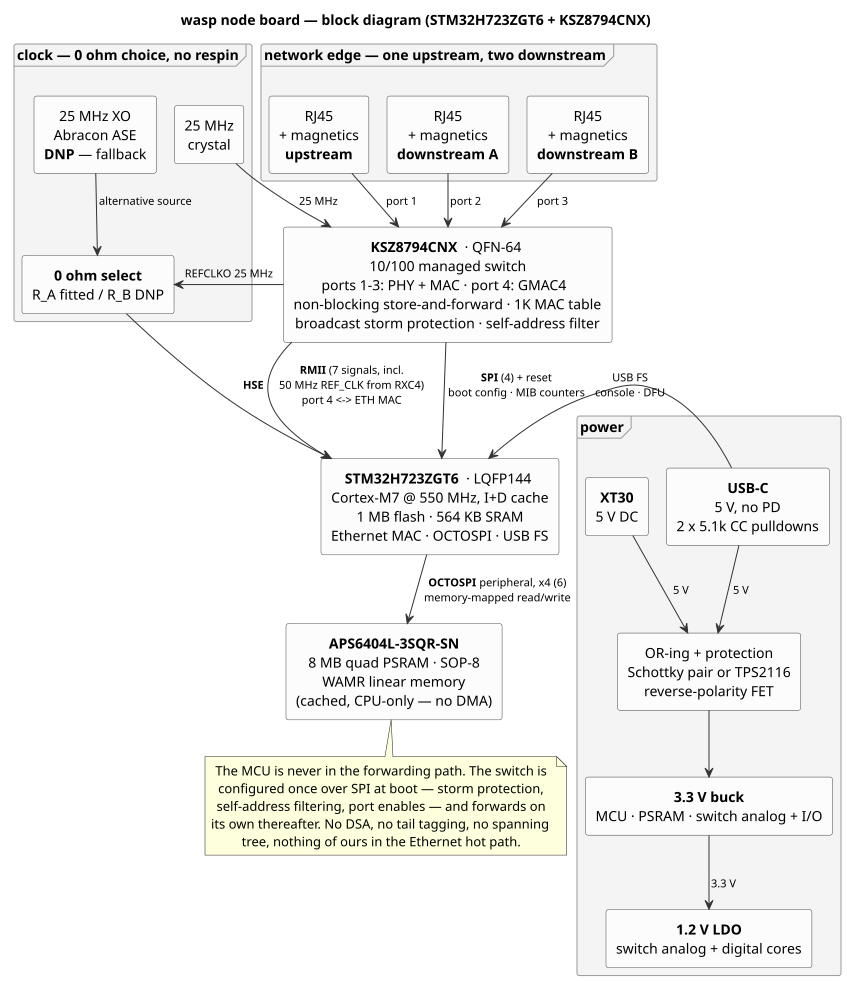

# Future hardware: a purpose-built wasp node board

Parked notes (2026-07-18, revised 2026-08-25) for a custom node board.
The point of the board is to run **wasp** well: enough RAM to host N
WAMR instances on one physical node (the "multiple instances per node"
roadmap item), and an Ethernet switch on every node so a fleet cables
itself together instead of fanning out to a desk switch. Nothing here
is started; this is the design rationale so it doesn't have to be
re-derived later.

Settled:

- **STM32H723ZGT6** — ~$11 @ qty 10, DigiKey (quoted 2026-08).
- **Quad PSRAM on the OCTOSPI peripheral** for WAMR linear memory —
  SOP-8, no BGA (see [PSRAM part selection](#psram-part-selection)).
- **KSZ8794CNX switch** — $6.22/unit, DigiKey (quoted 2026-08) —
  three copper ports (one upstream, two downstream) on an RMII link to
  the MCU. QFN-64 and its extra 1.2 V rail are both accepted.
- **No WiFi.** This is a wired board.
- **Self-powered nodes**: USB-C (5 V, no PD) and an **XT30** 5 V DC
  connector, OR-ed. No PoE.
- **USB-C carries data**, not just power: CDC-ACM console and DFU
  flashing over the same cable.
- **The MCU does not participate in forwarding.** The switch is
  configured once at boot and then runs autonomously — which, per the
  datasheet findings below, means **RSTP is out** and hardware storm
  protection is in.

Switch details below are verified against the KSZ8794CNX datasheet,
Microchip DS00002134C (2016–2021), unless marked otherwise.



## Why external RAM works (and its constraints)

WAMR is just C running out of a heap we hand it, so external RAM has
no fundamental blockers. The constraints are performance topology:

1. **The external RAM must sit behind a data cache.** The interpreter
   touches memory several times per opcode; on a core with no D-cache
   (Cortex-M4/M0+ — the F4's ART accelerator only covers flash) every
   access pays full bus latency, roughly a 3–8× interpreter slowdown.
   Behind a real D-cache (Cortex-M7-class) the penalty drops to tens
   of percent. This is the single biggest MCU-selection criterion.
2. **DMA coherence.** Cached external RAM + DMA masters (Ethernet MAC)
   is the classic STM32H7 bug-farm. Sidestep it architecturally:
   network buffers, DMA descriptors, kernel and thread stacks stay in
   internal SRAM; external RAM is CPU-only WAMR territory.
3. **Only the WAMR pool moves out** — module storage, linear memories,
   per-instance structures (~95% of the footprint, and exactly what
   multi-instance needs). Integration is one linker-section /
   devicetree change (Zephyr `shared-multi-heap`). The
   ≥64 KiB-contiguous-per-instance problem that dominates today's RAM
   budget disappears with megabytes of contiguous external RAM.
4. **Atomics are a non-issue.** `LDREX`/`STREX` to external buses can
   be unsupported, but wasp atomics are coordinator-side RPCs and WAMR
   is built without shared memory/threads. Keep OS sync primitives in
   internal SRAM.
5. **Interpreter-only keeps it simple.** No execute-from-external-RAM
   requirement; only AOT/JIT would need an XIP/I-cache path. Don't
   design for that.
6. **Bus bandwidth shared across instances won't bottleneck** before
   the CPU does, given the cache.

Also note: N instances on one core buy *concurrency and isolation*
(host several modules at once), not throughput.

## MCU choice

The deciding constraint: PSRAM-as-transparent-heap needs
**memory-mapped writes**, which means **OCTOSPI** — the H72x/H73x
line. The H743's QUADSPI only memory-maps reads (writes are
indirect-mode), which would force FMC SDRAM: ~45 length-matched pins
and big packages, the opposite of cheap.

> OCTOSPI is necessary but, as built, not sufficient: memory-mapped
> writes also turned out to depend on the *device width*, and on this
> silicon they do not work reliably to a **quad** PSRAM. The MCU choice
> is unaffected — an H72x/H73x is required either way — but the memory
> choice is. See *PSRAM part selection* for the measurements and the
> V2 decision to go octal. The H7A3/H7B3 have OCTOSPI
and 1.4 MB SRAM but dropped the Ethernet MAC — disqualified, and the
switch doesn't rescue them: the switch replaces the *PHY*, not the
MAC, so the MCU still needs one.

**Pick: STM32H723ZGT6** — LQFP144, 550 MHz M7 (I/D-cache), 1 MB
flash, 564 KB internal RAM, Ethernet MAC, OCTOSPI.

- **LQFP144 is the system-cost sweet spot**: 0.5 mm pitch, no
  via-in-pad, plain 4-layer stackup, hand-reworkable. BGA saves board
  area we don't need and costs HDI/6-layer + assembly yield.
- **RMII to the switch is the right interface**, and the reason the
  pin budget is comfortable: 7 signals against MII's 16, natively
  supported by the H7 MAC, and already the interface both fleet
  Nucleos run — so the `st,stm32h7-ethernet` side is proven silicon
  and proven driver. Budget: RMII (7) + switch SPI (4) + reset (1) +
  quad PSRAM (6) + USB D+/D− (2) + SWD + UART console. Dropping the
  PHY's MDIO/MDC pair
  pays for the switch's SPI, and dropping WiFi returns a UART.
  LQFP144 is not close to full; LQFP100 (H723VGT6) would now fit too,
  but saves only ~$1–2 and removes all headroom — stay at 144.
- **1 MB internal flash → no external flash, no custom bootloader.**
  This is why the tempting H730 value line (~$6, 128 KB flash) is a
  trap: Zephyr + net stack + WAMR won't fit, so it needs QSPI NOR +
  XIP boot complexity.
- Skip **H725/H735** (integrated SMPS: adds an inductor, complicates
  the power tree for nothing on a powered node) and **H733/H735**
  (crypto accelerators, unused).
- **Bring-up is free**: `nucleo_h723zg` is a supported Zephyr board in
  the same 144-pin Nucleo format as the F439ZI already in the fleet.
  Buy one (~$30), port the firmware, validate OCTOSPI PSRAM on a
  breakout — then the custom board is essentially the Nucleo, minus
  what we don't need, plus the switch. Stays on the existing gnuarmemb
  toolchain.

## Every node is a switch

Each node carries a **KSZ8794CNX** managed Ethernet switch. The
datasheet describes it as "intended for cost-sensitive applications
requiring three 10/100 Mbps copper ports and one 10/100/1000 Mbps
Gigabit uplink port" — concretely, three integrated 10/100BASE-T/TX
MAC/PHYs (ports 1–3) plus one GMAC on **port 4** with selectable
RGMII, MII, or RMII. Three copper ports go to RJ45 jacks; port 4 is
the internal RMII link to the H723's MAC. The node is therefore *both*
a switch in the fabric and a host on it — one MAC, one IP, exactly as
today.

**Three copper ports is the requirement, not a compromise: one
upstream, two downstream.** The part matches it exactly. Nothing
smaller in the family reaches three copper (KSZ8863/8873 and LAN9354
are 2 PHY + 1 MAC); the 5-port KSZ8795CLX buys a fourth we don't want.

> **Datasheet erratum to be aware of:** the Features list on page 1
> claims "Four Integrated IEEE 802.3/802.3u-Compliant Ethernet
> Transceivers." The general description, the MAC list ("Three
> internal MAC1–MAC3 units and one internal GMAC4"), and the pin
> table all say three. It is copy-paste from the 5-port KSZ8795;
> Microchip has a support article on KSZ8765/8775/8794/8795
> documentation updates. Three is correct.

### What it buys

- **No infrastructure.** Nodes chain node-to-node; the root's upstream
  port plugs into the house network for DHCP and the coordinator. A
  15-node fleet stops needing a 16-port switch and 15 cables back to
  it.
- **The switch outlives the firmware.** Switch silicon forwards
  independently of the MCU, so a node that is crashed, reflashing, or
  sitting in the bootloader **still passes traffic for the nodes
  behind it**. Only a power cut partitions the tree. This is a real
  property for a project whose demo deliberately kills workers
  mid-render (`CONFIG_WASP_CONDUCTOR_CHAOS`).
- **Discovery is unchanged.** ANNOUNCE is a UDP broadcast; the switch
  floods broadcast to every port, so `wasp_discover` sees the whole
  tree exactly as it sees a flat desk switch today.
- **One crystal for the pair.** The switch runs from a single 25 MHz
  ±50 ppm reference and can *output* the 50 MHz RMII reference clock
  to the MAC (strap: 25 MHz OSC in, 50 MHz RMII clock out on RXC4).
  No second oscillator, no clock-source negotiation with the H723.

### Magnetics

Per the datasheet's §9, the line interface wants a plain 10/100
transformer and nothing exotic:

| | |
| --- | --- |
| turns ratio | 1 CT : 1 CT |
| open-circuit inductance | ≥ 350 µH (100 mV, 100 kHz, 8 mA) |
| insertion loss | ≤ 1.1 dB, 0.1–100 MHz |
| HIPOT | ≥ 1500 V RMS |

Two details specific to this part: an **integrated common-mode choke**
is recommended ("for exceeding FCC requirements at line side"), and
the **RX/TX centre taps must be kept separate on the chip side**. They
do *not* need tying to analog power — the KSZ8794 biases and
terminates internally — which removes the per-port bias network a
discrete-PHY design would need.

**Isolation is not the axis to economise on.** 1500 V RMS is an 802.3
requirement, and it matters more here than usual: every node has its
own wall supply, so without magnetics a chain of fifteen would bond
all fifteen grounds together through the cabling. Every MagJack worth
buying clears it; there is no cheaper non-isolated option worth
considering.

What actually moves the price is **integrated versus discrete**
magnetics, and for a three-port board integrated wins clearly: three
parts instead of six, one differential-routing stage removed
(chip→jack rather than chip→transformer→jack), and less of the board
edge consumed, which is the scarce resource here. Also **do not buy
gigabit magnetics** — the copper ports are 10/100, so a 10/100/1000
MagJack costs more for bandwidth the switch cannot use.

### Latency: the fan-out of two is what saves it

The fabric is confirmed "non-blocking store-and-forward" — no
cut-through — so each hop re-serializes the whole frame. At 100 Mbit/s
that is 80 ns per byte plus ~2 µs of fabric: ~10 µs per hop for a
small RPC frame, ~86 µs for a 1 KiB one. Against the baselines in
[performance.md](performance.md) (~2.8 ms per Ethernet round-trip,
~3.2 ms for 1 KiB):

| fleet | max hops, coordinator at root | small RPC | 1 KiB bulk |
| --- | ---: | ---: | ---: |
| 7 nodes (depth 3) | 3 | +2 % | +16 % |
| 15 nodes (depth 4) | 4 | +3 % | +21 % |
| 15 nodes, cabled as one chain | 15 | +11 % | +81 % |

**This is the argument for two downstream ports.** A bus puts depth at
O(N) and makes bulk transfers pay for it; a binary tree puts depth at
O(log N) and the penalty stops mattering. Small RPCs — the thing that
actually governs wasp performance, per performance.md's T1 — are
unaffected either way, because they are overwhelmingly host-stack
time. But T2's "batch, don't peek" advice produces exactly the large
frames that pay per hop, so the topology rule earns its keep: **keep
the tree balanced, and put the coordinator at the root.**

Trunk bandwidth is *not* the binding constraint yet: a node issuing
1 KiB RPCs back-to-back at 2.8 ms each generates ~3 Mbit/s, so even
eight of them through a shared 100 Mbit/s trunk sit around a quarter
of the link. Module pushes and framebuffer dumps are the bursts to
watch, not steady RPC traffic. Port 4 is gigabit-capable over
RGMII/GMII, but the H723's MAC is 10/100, so RMII at 100 Mbit is the
matched choice and costs us nothing we had.

### RSTP: real, but it runs on the MCU

The datasheet does list it — "Rapid Spanning Tree Support (RSTP) for
Topology Management and Ring/Linear Recovery." What that means in
practice is settled by **Table 3-13, titled "Port Setting and Software
Actions for Rapid Spanning Tree"**: for each RSTP port state the table
gives a register setting *and* a required processor action. The
Discarding state is "Transmit enable = 0, Receive enable = 0, Learning
disable = 1," annotated "**The processor** should not send any packets
to the port… the processor should discard those packets," with the
note "processor is connected to Port 4." Disabling learning means the
host writes Register 2 Bit[5]/Bit[4] to flush the port's dynamic and
static MAC-table entries.

So the switch supplies the *primitives* — per-port transmit/receive
enable, learning disable, MAC-table flush, plus **tail tagging** on
port 4 (one byte before the FCS telling the processor which ingress
port a frame arrived on, which is exactly what a BPDU handler needs).
The 802.1w state machine itself — port roles, timers, the
proposal/agreement handshake, topology-change propagation — is host
software. Zephyr has none (verified: no STP/RSTP/BPDU code in 4.4.1
outside gPTP's unrelated state machine), and Zephyr 4.4 additionally
*deleted* the `microchip,ksz8794` DSA driver that would have supplied
tail-tag handling, because nobody migrated it to the reworked DSA
subsystem (upstream PR 105926, `doc/releases/migration-guide-4.4.rst`).

**This is incompatible with the goal.** Running RSTP would put the MCU
in the forwarding path — tail-tag insert/strip on every frame through
the Ethernet hot path, plus a protocol state machine — which is
precisely what this board is supposed to avoid. **RSTP is therefore
out**, and the KSZ8794 stays: no other 10/100 switch IC runs 802.1w
autonomously either, so this is not a part-selection problem. (The
chips that do are switch SoCs with an application core running Linux
and `mstpd` — a different board and a different price class.)

**Deferring this forecloses nothing.** Everything 802.1w would need is
already on the board because it is needed for other reasons: port 4 is
the CPU port (tail tagging is a register setting away), the SPI link
reaches the port-state and static-ALU registers, and the cabling itself
permits closing a ring — plugging a leaf's downstream port into another
leaf is a patch cable, not a respin. RSTP here is a pure software
decision, deferrable indefinitely at zero hardware cost, and the
topology is stable enough (this is wired Ethernet on a desk, not a mesh
radio) that convergence speed was never going to be the deciding factor.

**And with a tree, none of this is needed anyway.** RSTP breaks loops
in topologies that have them; one upstream and two downstream ports,
cabled as intended, has no cycle to break. Committing to the tree
means committing to *zero* lines of spanning-tree code — not a reduced
amount. What remains is a boot-time SPI configuration routine, which is
a different kind of thing entirely (see
[below](#software-configure-once-then-get-out-of-the-way)). The
primitives Table 3-13 describes still get used, just not by a protocol
— see the port watchdog in the next section.

Worth noting what we give up is smaller than it looks: RSTP converges
in **seconds**. Against 2.8 ms RPCs, any topology change has already
killed every TCP connection through the failed link, so the
coordinator sees `E_CONN` and marks those workers dead long before the
fabric heals. RSTP would restore the fabric for the *next*
`wasp_discover`; it would not rescue an in-flight render. The chaos
recovery path already handles that case and already works.

### Loop protection without the MCU

Two hardware features cover the actual risk, which is miscabling
rather than the intended topology (a tree has no cycle to storm
around):

- **Broadcast Storm Protection with Percentage Control**, global and
  per-port. Rate parameters are programmed globally and the feature is
  enabled or disabled per port; after that it is enforced in hardware.
- **Self-address filtering** — Global Control 18 Register Bit[6], with
  the switch's own MAC in Registers 104–109. Packets sourced by the
  switch itself get filtered at the egress port, so a frame that
  loops back around is dropped rather than circulated.

Both are set once at boot and then run without the processor. There is
**no autonomous loop-detect-and-disable-port feature** in this part, so
on hardware alone a closed ring is still a fault — it degrades instead
of melting. **Topology rule: build a tree, do not close the ring.**

If that ceiling is too low, there is a third tier that costs far less
than RSTP and keeps the MCU out of the data path entirely: an
**out-of-band port watchdog**. The part carries 36 MIB counters per
port; a low-priority thread can poll them over SPI every few seconds,
and a port whose broadcast/multicast rate has the signature of a loop
gets shut down by writing the *same* registers RSTP would have used —
transmit enable = 0, receive enable = 0 — followed by a log line and,
naturally, a report over the wasp protocol.

That is loop detection with none of RSTP's costs: no BPDUs, no tail
tagging, no state machine, no per-frame involvement, nothing in the
Ethernet hot path. It is slow (seconds, like RSTP's own convergence)
and it is unilateral rather than a negotiated topology — which is
exactly right for a tree, where there is no alternate path to
negotiate toward. Call it a day of work rather than weeks, and it is
strictly optional: the two hardware features above are the v1 story.

### Software: configure once, then get out of the way

The switch is managed over **4-wire SPI up to 25 MHz** (client mode
selected by pulling SPIQ down; MDC/MDIO is the alternative, but it
reaches only the MIIM PHY registers, not the switch registers we
need). There is also an I/O pin strapping facility that sets certain
register bits at reset — enough for basic operation, but storm
protection and self-address filtering need real register writes, so
SPI it is.

That gives the v1 firmware story. It turned out to be smaller than
the list below, and one item on it is not optional at all:

- a **boot-time SPI config routine** (`app/src/net/ksz8794.c`). This is
  configuration, not forwarding: after it returns, the MCU is a plain
  node on its own switch and never touches a frame it didn't send.

  The one mandatory write is **port 4's interface mode**. The strap pins
  that select it, LED3[1:0], both have internal pull-ups and so read
  `11` = RGMII; on this board they drive J5's RJ45 LEDs through R22/R23,
  so nothing pulls them down. The board is wired RMII. Until register 86
  (0x56) bits[1:0] say `01`, port 4 neither speaks RMII nor emits the
  50 MHz reference clock the MCU's MAC runs on, and not one frame moves.
  Measured, not theorised: before the write, DHCP never completes; after
  it, the board gets a lease in about 6 s.

  Two documentation traps are worth knowing. The data sheet's register
  map (Table 4-2) lists 0x56–0x58 as factory-test registers — it was
  copied from the 5-port KSZ8795 and labels two blocks "Port 4"; the
  detailed descriptions and the functional text both have 0x56 as Port 4
  Interface Control 6. And section 3.5.1.1 claims 8-bit SPI opcodes
  0x03/0x02, contradicting its own figures 3-7/3-8: the real frame is a
  3-bit opcode, a 12-bit address, a turnaround bit, then 8 data bits, so
  the header is `(op << 13) | (addr << 1)`. Linux's `ksz8795_spi.c`
  agrees with the figures.

  The switch does **not** need starting — register 1 bit[0] resets to 1
  — and the SW4 port already resets to 100 Mbps full duplex, matching
  the fixed link below.

  Self-address filtering is deliberately *not* enabled. It drops frames
  whose source matches the switch MAC on egress, which is right for a
  daisy chain that can loop a broadcast back; but with the MCU's own MAC
  configured there, every frame the MCU transmits also matches on
  egress, and the data sheet never says whether the ingress port is
  exempt. It waits for a second node to test a chain with.

- a **clock-tree detail the switch forces on the MCU**: every SPI1/2/3
  on the H7 takes its kernel clock from PLL1_Q, and the HSI-only bring-up
  build runs no PLL. SPI3 (and SPI2, since SPI123SEL is one shared RCC
  field) must be reparented onto CKPER = HSI, or `spi_stm32_init()` fails
  the domain-clock select and the management bus never initialises.
- the MCU's RMII link declared as a **fixed link** — Zephyr 4.4's
  `ethernet-phy-fixed-link` compatible with `default-speeds`, since
  there is no PHY to auto-negotiate with on that side — on top of the
  stock `st,stm32h7-ethernet` driver.
- **no tail tagging, no DSA, no per-port netdevs.** All three exist to
  put the CPU in the forwarding path. We don't want it there.

The SPI link earns its keep beyond boot anyway: the part has 36 MIB
counters per port, which are a natural thing for a wasp node to report
over the protocol and the cheapest way to see the fabric from
software. Port mirroring is also available, which makes packet-capture
debugging of the wasp protocol possible without a tap.

### What this breaks or constrains

- **No ring redundancy.** Settled above, and a deliberate trade.
- **Power is now the partition risk.** The "a dead node still
  forwards" property holds only while its switch is powered. Worth
  deciding whether the switch rail is independent of anything the
  firmware can brown out.
- **The power tree grows a rail** (accepted). The KSZ8794CNX needs
  3.3 V analog and **an external 1.2 V LDO for its analog and digital
  cores**; VDDIO can be 3.3/2.5/1.8 V. So: 3.3 V buck + a 1.2 V LDO,
  where the single-PHY design had one rail — a cheap, easy part.
- **The switch is QFN-64, not LQFP** (accepted). Lead-free RoHS 64-pin
  QFN — no BGA, no HDI, but leadless, so it wants hot air or a stencil
  rather than an iron, and the thermal pad wants a via array. Ordinary
  4-layer fab, but the "hand-reworkable" claim covers the MCU, not
  this part.
- **Board area and BOM grow.** Three RJ45 jacks need ~60 mm of board
  edge and roughly double the BOM (below).
- **The proven-PHY argument is gone.** The LAN8742A was chosen partly
  because the Nucleos already use it, so the driver was known-good.
  The switch replaces it, and the MCU-side link becomes a fixed link
  with no PHY driver at all — simpler, but new.
- **No WiFi means no mixed-transport story.** performance.md's ~8×
  WiFi-vs-Ethernet RPC comparison stays valid as measured history, but
  this board can't reproduce it. Existing Pico W nodes still can.
- **The switch's LED pins are also its strap pins** (`Ipu/O`: input
  while reset is asserted, sampled and latched at release, output
  thereafter). The hazard is that the jack LED circuit is present
  during sampling, and LED drive polarity is fixed — "LED is ON when
  the output is LOW" — so LEDs must hang off 3.3 V through a resistor
  into the pin, which fights any pull-down. A 330 Ω LED resistor
  against a 10 kΩ pull-down settles the node at ~1.26 V, in the
  undefined band between VIL and VIH: the LED wins and the strap is
  ignored.

  **Resolved by not strapping at all.** Register 86 (0x56) sets the
  same configuration over SPI — bits [1:0] select the Port 4
  interface (`11` RGMII default, `01` RMII) and bit [7] picks the RMII
  clock source — so both go in the boot-time SPI routine and every
  jack LED can be wired the ordinary way with no strap resistors.
  Before that code runs the switch sits in RGMII, which is harmless
  because nothing drives Port 4 yet; `LED2_1` and `LED2_0` default
  high, which are the wanted values anyway. The second matters at
  power-up, since REFCLKO feeds the MCU's HSE before any SPI can run.

- **Two pins do need resistors, neither of them an LED.** `SPIQ` picks
  SPI against MDC/MDIO — its internal pull-down already selects SPI
  client mode, but the datasheet requires an explicit external
  resistor, so fit a 10 kΩ pull-down (it is also the MISO line). And
  `ISET` wants **12.4 kΩ 1%** to ground, which sets the PHY transmit
  current for a 1:1 transformer — the tolerance is load-bearing.

- **Bring-up order:** hold `RST_N` low, release, SPI-configure
  (register 86 for RMII plus internal clock, storm protection,
  self-address filtering, port enables), then start the MAC. Worth
  verifying whether changing register 86 bits [1:0] after boot needs
  a soft reset.
- **The ARP-table gotcha still applies**, and is independent of
  topology: a conductor holding N peer connections needs
  `CONFIG_NET_ARP_TABLE_SIZE` raised from Zephyr's default of *two*
  (see `app/conductor.conf`).

## PSRAM part selection

**APS6404L-3SQR-SN** (AP Memory) — 64 Mbit (8 MB), quad (x1/x4) SDR,
133 MHz, 2.7–3.6 V, **SOP-8**.

### Why not octal — the v1 reasoning, and why it was wrong

> **Superseded.** This section records the v1 decision and the argument
> behind it. Hardware disproved the argument. V2 goes octal — see
> *V2: go octal* below. Kept because the mistake is instructive and
> because the packaging and stub analysis further down is still correct.

The v1 argument was that octal PSRAM does not exist in a
hand-solderable package. The x8 market has standardised on one
24-ball, 6×8 mm miniBGA footprint — AP Memory, ISSI and Winbond all
ship it and nothing else. That part is accurate and still true.

The step that was wrong was the next one: that **the memory-mapped
write came from the peripheral, not the device width.** The premise is
right — the H743's QUADSPI memory-maps reads only while OCTOSPI maps
reads *and* writes, and OCTOSPI does drive x1 through x8 alike — but
the conclusion drawn from it, that "a quad PSRAM on the OCTOSPI
peripheral is transparently read/write mapped exactly as an octal one
would be", does not hold on this silicon.

What actually happens, measured on the fitted board:

- Memory-mapped **reads** of the whole 8 MB are correct.
- Memory-mapped **writes** fail in two different ways depending on one
  bit. With `DQSE` clear in `OCTOSPI_WCCR`, a write returns an error
  response and leaves the controller asserted and `BUSY`
  (`OCTOSPI_SR` = 0x20: BUSY set, TEF clear), which reaches the CPU as
  an imprecise bus error. Setting `DQSE` — the documented workaround,
  and necessary even though this package has no DQS pin — clears that
  and exposes the second failure: writes whose AXI byte enables are not
  all asserted corrupt the lanes that should have been masked. About
  one word per 352 bytes reads back as zero across the array.
- Ruled out by experiment: sampling (identical at 68.75 MHz and
  19.6 MHz), tCEM enforcement and burst chopping (unchanged with the
  refresh counter disabled and the chip-select boundary at 32 bytes
  instead of 1 Kbyte), and the D-cache (unchanged with the region
  non-cacheable).

The mechanism is an acknowledged STM32 limitation, not a wiring fault
or a bad part: on an AXI-attached OCTOSPI, memory-mapped writes are
issued in multiples of the 64-bit bus width, and the DQS workaround
that makes them complete at all also makes byte-enable masking stop
working. ST's own guidance for the same symptom on an H7B0 with an
APS6404L — the exact part this board specifies — is to use an **octal
(OPI) PSRAM instead**. So the device width was never incidental to
memory-mapped writes; it is the thing that decides whether they work.

Two corollaries worth stating plainly, because the v1 text implies the
opposite:

- Fitting the specified APS6404L would not have fixed this. The ST
  report describing the identical failure *is* an APS6404L. The part
  actually fitted is a **VTI7064MSME** (a Vilsion quad PSRAM, same
  pinout, package, density and command set, but tCEM 4 µs rather than
  8 µs, and a Rev 0.1 "Preliminary" datasheet that contradicts itself
  on the clock ceiling). It behaves correctly in every mode the
  controller supports: indirect QPI round trips, memory-mapped reads of
  all 8 MB, and short memory-mapped writes at 64, 32, 16 and 8 bit
  widths. The device is not the problem.
- The MCU choice does still stand. An H72x/H73x is required either
  way; OCTOSPI is what makes octal possible at all.

The quad part did deliver on everything else claimed for it — same
8 MB, same 2.7–3.6 V single rail, same self-managed refresh — with one
exception that only showed up when buying: **it has been persistently
hard to source.** The APS6404L is Mouser-only in practice, LCSC lists
it as unavailable, and the LY68L6400 alternative is likewise absent;
the board shipped with a Vilsion substitute because that was what could
be bought. "Jellybean, stocked everywhere" was true of the device class
on hobby boards, not of any orderable line item.

### V2: go octal

**Decision: revision 2 fits an octal PSRAM.** `APS6408L-3OBM-BA`
(2.7–3.6 V — note the `-3`; the bare `-OBM` is the 1.8 V part and would
need a third rail plus level translation), 24-ball miniBGA.

Four reasons, in order of weight:

1. **It is the configuration that works.** Memory-mapped writes are
   the whole point of putting RAM here — WAMR's linear memory is a
   plain `uint8 *` that the interpreter stores through directly, so
   there is no indirect-write path to hide behind. Octal with DQS is
   ST's recommended answer to exactly the failure measured above.
2. **It is the configuration with a driver.** Zephyr already ships
   `drivers/memc/memc_stm32_ospi_psram.c`, and it is an octal
   HyperRAM/Xccela driver for APS256XX-class parts — 8-line
   instruction, address and data, `MEMTYPE_APMEMORY`, mode registers
   over a DQS-clocked DTR bus. It was useless for a quad part, which
   is why `app/src/mem/psram.c` exists. Going octal makes the upstream
   driver the right one; the remaining work is relaxing its
   `depends on SOC_SERIES_STM32U5X` and checking it against the H7
   OCTOSPI HAL, which is a far smaller job than fixing a controller
   erratum from underneath.
3. **4× the bandwidth and ~3× lower miss latency**, per the table
   below — which stops being a "nice if the cache misses hurt"
   argument once linear memory genuinely lives out there.
4. **Sourcing.** The 24-ball BGA is a standardised footprint with
   three vendors shipping it (AP Memory, ISSI, Winbond), against a
   quad SOP-8 that in practice meant one distributor and a substitute
   part. The package is harder; the supply is easier.

What it costs: BGA-24 is not hand-solderable, so assembly needs a
stencil and either hot air or reflow, and the escape routing needs the
4-layer stack this board already has. DQS becomes a real signal to
route and length-match with the clock, and the data bus doubles to
eight lines.

Not to be revisited on the way: the dual-footprint hedge below is
still a bad idea for the same stub-length reason, and if hedging is
genuinely wanted the H723's second OCTOSPI instance is the way to do
it.

### What it costs

| | quad @ 84 MHz SDR | octal @ 133 MHz DTR |
| --- | ---: | ---: |
| peak bandwidth | ~66 MB/s | ~266 MB/s |
| 32 B cache-line fill | ~590 ns | ~200 ns |

So **4× the bandwidth and ~3× the miss latency** — real, and paid only
on cache misses. Whether that is visible depends entirely on how well
the H723's D-cache holds an interpreter's working set, which is an
empirical question and one the bring-up plan already answers: the
Nucleo + breakout step measures it before any copper is committed. The
constraints section above argues bandwidth won't bottleneck before the
CPU does; this is the measurement that confirms or refutes it.

If it refutes it, the BGA part (**APS6408L-3OBM-BA**, 2.7–3.6 V — note
the `-3`; the bare `-OBM` is the 1.8 V version and would need a third
rail plus level translation) is the upgrade path.

### Don't try to hedge with dual footprints

Tempting, given the 0 Ω philosophy elsewhere on this board, and wrong
here. The quad signals are a subset of the octal ones, so both
footprints could share nets — but the unpopulated one then hangs off
the bus as an unterminated stub. At octal DTR speeds (~1.9 ns unit
interval) the usable stub length is a couple of millimetres, which no
sane placement achieves. If hedging is genuinely wanted, the H723 has
two OCTOSPI instances (verify on the datasheet), so the two parts can
sit on separate buses with no shared nets — at a cost in pins and
area, both of which this board has spare.

### Practical notes

- **KiCad already has everything.** The stock symbol
  `Memory_RAM:APS1604M-SQRx-SN` carries the identical SOP-8 pinout
  (CE#=1, SO/SIO1=2, SIO2=3, VSS=4, SI/SIO0=5, SCLK=6, SIO3=7,
  VDD=8) and the right footprint,
  `Package_SO:SOIC-8_3.9x4.9mm_P1.27mm`. Copy it into the project
  library as `APS6404L-3SQR-SN` and fix the value and datasheet — the
  stock symbol's description quotes its 1.8 V sibling's supply range,
  which is not this part's.
- **tCEM still applies.** The refresh is self-managed internally, but
  chip select still cannot stay low indefinitely.
  `OCTOSPI_DCR3.MAXTRAN` and the `REFRESH` field must be set from the
  part's tCEM, or the failure mode is silent corruption that presents
  as random memory faults. AN5050 has the calculation.
- **Validate before committing copper.** Community reports of PSRAM
  on H723 OCTOSPI include deadlocks and debugger crashes. If the
  interface fights back, HyperRAM is the fallback — the same
  peripheral speaks HyperBus natively — but note that HyperRAM is
  BGA-only too, so it is a last resort on this board rather than a
  free swap.

## Power

**Each node powers itself**, from either of two 5 V inputs:

- a **USB-C receptacle**, 5 V only — no PD, no negotiation;
- a **5 V DC connector** for bench and rack use.

### Why not PoE

Tempting on a self-cabling board, and rejected on cost and topology.
A tree node would need to *receive* power and *pass it on*, meaning a
PD **and** a PSE per node — two sets of PoE magnetics plus controllers,
on a board whose entire premise is being cheap. Passive injection down
the spare pairs (100BASE-TX leaves 4-5 and 7-8 free) avoids that, but
not physics: 5 V over 24AWG is ~0.17 Ω/m round trip, so even a 10 m run
at 400 mA costs ~0.7 V, and a 100 m run is hopeless. Passive injection
only works at a higher voltage with a local buck per node, which is a
different design. Self-powered nodes it is.

### Budget

Rough, pending the measurement in the open questions:

| | |
| --- | ---: |
| STM32H723 @ 550 MHz | ~0.8 W |
| KSZ8794CNX, three links up | ~0.5 W |
| PSRAM + LEDs + misc | ~0.3 W |
| **total** | **~1.6 W** |

At 5 V with buck losses that is roughly **0.5 A** — comfortable against
USB-C's usual 5 V/1.5 A or 3 A. The one marginal case is a host port
that only offers default USB current (500 mA); that is an argument for
treating the DC jack as primary and USB-C as convenience, not for
adding PD.

### Two gotchas worth designing in now

1. **USB-C needs two 5.1 kΩ pulldowns, one on each CC pin.** Without
   them a compliant C-to-C source detects no sink and supplies
   *nothing* — the port looks dead, and it is the single most common
   USB-C power-input mistake. They are two resistors; there is no
   excuse for getting this wrong on a fleet of fifteen boards.
2. **OR the two inputs.** With both connected, whichever is higher
   would otherwise backfeed the other. A Schottky pair is the cheap
   answer and the ~0.4 V drop is irrelevant ahead of a 5 V→3.3 V buck;
   a power-mux IC (TPS2116 class, ~$1) buys deterministic priority —
   prefer the DC jack, fall back to USB — if that is worth a dollar.

Add **reverse-polarity protection** on the DC input regardless: a
series P-FET is cents, and hand-made pigtails get miswired by humans.
A PTC and a TVS on both inputs are cheap insurance at fleet scale.

### Connector: XT30

**Decided: XT30** for the DC input. The de facto robotics/RC standard
at this scale — polarized and keyed so it cannot be mated backwards,
~$0.30, rated 30 A (absurd headroom for 0.5 A, but headroom is not a
cost), and the pigtails and 5 V supplies already exist in any robotics
drawer. Needs mating pigtails made up, which is the only real downside.

Considered and passed over: a 2-pin 5.08 mm pluggable terminal block
(Phoenix MC style), field-wireable with a screwdriver and no crimping;
and a 5.5×2.1 mm barrel jack, which is unpolarized by convention only
and the source of a thousand reverse-polarity stories. The
reverse-polarity FET stays in either case — XT30 pigtails are made by
humans.

### v1 erratum: the USB data pair never reaches the MCU

**USB power works on the v1 board; USB data cannot.** Two independent
wiring faults, both in the stretch between J7 and the MCU, both of the
same kind — a part whose pins were assigned as though its internal
topology were something else. Neither is a layout or a fabrication
problem; the copper faithfully implements the schematic.

**U2, the USBLC6-2SC6 ESD array.** Its six pins are four nodes, not six:
pins 1 and 6 are both `I/O1`, pins 3 and 4 are both `I/O2`, with pin 2
GND and pin 5 VBUS. It is a *shunt* protector — a line is tapped off one
of a pair's pins and the diodes clamp it — so the two pins of a pair are
internally the same wire. The schematic instead treats 1/6 as one side of
the device and 3/4 as the other, and assigns:

| pin | node | net | consequence |
| --- | --- | --- | --- |
| 1 | I/O1 | `USB_EMI_D_P` | shorts the MCU-side pair |
| 6 | I/O1 | `USB_EMI_D_N` | " |
| 3 | I/O2 | `USB_CONN_D_N` | shorts the connector-side pair |
| 4 | I/O2 | `USB_CONN_D_P` | " |

To be precise about where the shorts are, because it is easy to blame the
wrong part: J7 itself is wired correctly. Tying A6 and B6 together as D+
and A7 and B7 together as D− is not a mistake, it is what makes the
receptacle work with the cable either way up. The shorts are created by
U2, which bridges two nets that should be distinct:

```
USB_CONN_D_P   J7.A6(D+)  J7.B6(D+)   U2.4(I/O2) ─┐ one internal node,
USB_CONN_D_N   J7.A7(D-)  J7.B7(D-)   U2.3(I/O2) ─┘ so U2 joins the nets

USB_EMI_D_P    FL1.1      U2.1(I/O1)  ─┐ likewise
USB_EMI_D_N    FL1.2      U2.6(I/O1)  ─┘
```

And nothing bridges the `CONN_*` nets to the `EMI_*` nets: U2 was meant
to be that bridge — signal in on pin 1, out on pin 6 — and as wired it is
not, so the connector half and the MCU half are simply disconnected. Both
shorts exist only while U2 is fitted. ERC cannot see any of it, because
every pin is a distinct schematic pin and the connection is inside the
package.

**FL1, the common-mode choke.** Mounted with a Pulse `PH9455x105NL`
symbol against an `ACM2012_TDK` footprint for a TDK ACM2012-361-2P. Both
the symbol's pin geometry and the footprint's pad geometry put pins 1 and
2 on one side and **4 top, 3 bottom** on the other — so the windings are
1↔4 and 2↔3. The nets are assigned as if they were 1↔3 and 2↔4:

| winding | carries |
| --- | --- |
| pads 1↔4 | `USB_EMI_D_P` → `USB_D_N` |
| pads 2↔3 | `USB_EMI_D_N` → `USB_D_P` |

That crosses D+ and D−. The unusual 1,2 / 4,3 numbering is the whole
trap, and a substituted symbol is exactly where it bites.

Everything either side of those two is correct: J7 ties A6/B6 to D+ and
A7/B7 to D− so the cable works in both orientations, R1/R2 are the 5.1k
CC pull-downs, and PA11/PA12 carry DM/DP the right way round.

**Rework, two jumpers and no trace cutting.** The faults cancel, which
makes the fix much tidier than it has any right to be. U2 has to come off
regardless — mounted, it shorts the pair. With it removed, jumper *across
its own footprint*, deliberately crossed:

- U2 pad 4 → pad 6 (hop over pad 5, VBUS)
- U2 pad 3 → pad 1 (hop over pad 2, GND)

Then D+ runs J7 → `CONN_D_P` → pad4 → pad6 → `EMI_D_N` → FL1 pad2 → pad3
→ `USB_D_P` → PA12, and D− runs J7 → `CONN_D_N` → pad3 → pad1 →
`EMI_D_P` → FL1 pad1 → pad4 → `USB_D_N` → PA11. Both correct, and FL1's
crossing is what cancels the crossing the jumpers introduce, so the
common-mode choke stays in circuit. Only the ESD protection is lost,
which is acceptable on a bench board.

Both jumpers run between two pins on the same side of a SOT-23-6, hopping
one pad, so neither crosses the other.

**V2 fixes:** give U2 pins 1 and 6 the same net (D+) and pins 3 and 4 the
same net (D−), and give FL1 a symbol whose pin numbering matches the
ACM2012 footprint — or a footprint matching the Pulse symbol. The
underlying lesson is the one already recorded for the PSRAM: a
substituted symbol and footprint have to be checked pin by pin against
the real part, because ERC and DRC both pass regardless.

A cheap mechanical check for this class of fault, which found both of
these, is to group every footprint's pads by the symbol's own pin-function
name and flag any group spanning more than one net. On this board it
returns U2's two shorts plus one false positive — the MCU's VCAP1/VCAP2,
internally tied but correctly given a decoupling cap each.

### USB: power, console, and flashing

The connector is going in for power anyway, so it carries data too.
Two pins and a protection part buy three things:

- **A CDC-ACM console.** Zephyr's USB device stack (the
  `usb_device_next` stack on 4.4.1) exposes a serial console over the
  same cable that powers the board.
- **DFU flashing with no programmer.** The H723's ROM system
  bootloader speaks USB DFU, so `dfu-util` flashes a bare board.
  Bring a **BOOT0 button or test point** out to enter it; once Zephyr
  is up, a software jump can do the same without the button.
- **One cable per node on the bench.** On a fleet of fifteen that is
  the difference between a workbench and a nest.

Mechanics worth getting right the first time:

- **USB 2.0 Full Speed only** — the H723's OTG_HS has an internal FS
  PHY, so no external ULPI PHY. D+/D− land on PA11/PA12 (confirm
  against RMII and OCTOSPI assignments in CubeMX before layout).
- **48 MHz comes free.** HSI48 with the clock recovery system trimming
  against USB SOF meets FS accuracy without another crystal, so USB
  does not constrain the HSE choice below.
- **Bridge the two D+/D− pin pairs.** On a 16-pin receptacle, tie
  A6↔B6 and A7↔B7 so the cable works either way up. USB 2.0-only
  receptacles do it internally; the 16-pin ones do not, and a
  one-orientation USB port is a maddening bug to chase.
- **`SBU1`/`SBU2` go nowhere.** They carry Alternate Mode sideband
  signals (DisplayPort AUX and friends) and debug-accessory mode; a
  USB 2.0-only device with no PD uses neither. Leave them open, but
  put explicit no-connect flags on both so ERC passes and the intent
  reads as deliberate rather than forgotten.
- **ESD protection on the data pair** — a USBLC6-2SC6 or equivalent,
  ~$0.15, non-negotiable on a connector humans touch.
- **Keep a UART console on a header.** A USB console needs the USB
  stack up, so it tells you nothing about a hardfault during early
  boot — exactly when a networking board is most likely to die. Three
  pins and a header preserve the always-works path the current fleet
  debugs with.

### Clocking: pick it with 0 Ω resistors

The switch's optional **REFCLKO (25 MHz)** output could drive the
MCU's HSE, leaving the whole board on a single crystal. Whether its
jitter suits a PLL source is not something the datasheet answers
cleanly, and it is not worth a respin to find out.

**So don't choose at design time — choose at build time.** Lay out
both sources into an 0 Ω select:

- **R_A** (fitted by default) connects the switch's REFCLKO to the
  MCU's OSC_IN;
- **R_B** (DNP) puts a **25 MHz oscillator** — Abracon
  `ASE-25.000MHZ-L-K-T` (±30 ppm) or the `-C-` ±50 ppm variant, itself
  DNP — there instead.

A second crystal was considered for this slot, on the grounds that it
reuses a part already on the board and adds no BOM line. Rejected:
that argument is weak for a part that is never fitted, and it costs
the three things below, all of which land exactly when you would be
populating it.

PCB area is the cheapest thing on this board. A do-not-place line in
the BOM is a strictly better outcome than a respin, and if REFCLKO
turns out to be clean enough, the oscillator footprint simply stays
empty forever at a cost of a few square millimetres. If it doesn't,
populating two parts fixes it without touching copper. Same reasoning
applies anywhere else a cheap footprint buys out a risk.

Note that USB does not enter into this: HSI48 + CRS covers the 48 MHz
domain regardless of which HSE source wins.

### The switch's 25 MHz reference — the one clock that matters

Everything Ethernet times off this crystal, so it is the only
load-bearing oscillator on the board. Datasheet §10:

| | |
| --- | --- |
| frequency | 25.000000 MHz |
| tolerance | ≤ ±50 ppm |
| load capacitance | ≤ 27 pF |
| ESR | ≤ 40 Ω |

**Two traps here, and the jellybean part falls into both.** The common
3225 25 MHz crystals — Abracon ABM8G and its lookalikes — are **60 Ω
ESR**, half again over the limit. An oscillator driven below its
required negative-resistance margin starts unreliably, and ESR climbs
as it gets colder, so this is the classic "fine on the bench, dead in
the garage in January" failure. The second trap is reading ±50 ppm as
an initial-tolerance number: it is the **total** budget, so a ±30 ppm
part that drifts another ±30 ppm over temperature is out of spec at
±60 ppm. Buy on the total.

**Pick: Epson TSX-3225 series**, which has 25 MHz variants that clear
both — e.g. `TSX-3225 25.0000MF10P-C0` (±10 ppm, CL 18 pF, 40 Ω),
where the tight initial tolerance leaves the whole temperature budget
free, or `TSX-3225 25.00M-N0YYYYG30RGB` (±30 ppm, CL 20 pF, 30 Ω) if
its ±30 ppm turns out to be inclusive of temperature — worth checking,
because that part's ESR margin is the better of the two. KiCad has the
footprint (`Crystal:Crystal_SMD_3225-4Pin_3.2x2.5mm`). Load caps are
2 × (CL − ~4 pF stray) each: ~27 pF for an 18 pF part, ~33 pF for a
20 pF one.

**The escape hatch, if the crystal is fussy at bring-up:** XI takes a
3.3 V oscillator directly — "when using a 3.3 V oscillator, this is
the input from the oscillator" — with XO left floating. No respin
needed to change your mind.

### The MCU's HSE is not load-bearing

Worth stating plainly, because it sets how much to care about the
0 Ω select above: **nothing on this board needs an accurate HSE.** The
RMII clock comes from the switch, so MAC timing does not depend on it;
USB runs from HSI48 + CRS; the UART console tolerates a percent. HSE
feeds the core PLL and nothing else, and the PLL has no accuracy
requirement.

So the fallback ladder is three deep, not two: REFCLKO, then the DNP
oscillator, then — costing no parts at all — the H723's internal
64 MHz HSI. Populate the oscillator only if REFCLKO proves actively
dirty rather than merely imperfect.

Why the oscillator rather than a second crystal:

- **The firmware does not change.** Both REFCLKO and an XO present a
  CMOS clock on OSC_IN, so HSE runs in **bypass** mode either way. A
  crystal would force HSE into crystal mode, meaning a second clock
  configuration on a fleet whose boards may be populated differently.
- **OSC_OUT (PH1) stays free.** Bypass mode never drives it. A crystal
  needs both pins, so it would reserve PH1 for a part that is
  probably never fitted.
- **No gain-margin analysis.** An XO is a closed, validated loop. A
  crystal on the H723's HSE wants an AN2867 gm-margin check — and the
  entire premise of this slot is *the primary clock did not work out*,
  which is the wrong moment to be evaluating a second oscillator's
  startup behaviour.

Against that, the oscillator costs an extra BOM line and roughly a
dollar more per unit — neither of which is paid while it stays DNP.

The select is therefore genuinely one resistor: R_A or R_B, one clock
into OSC_IN, bypass mode, nothing else changes. Put a 22–33 Ω series
damping resistor at the source end of the 25 MHz trace.

Note the footprints are **not** interchangeable despite both being
3.2×2.5 mm 4-pad: pin 4 is ground on a crystal and VDD on an
oscillator, so the XO needs its own
(`Oscillator:Oscillator_SMD_Abracon_ASE-4Pin_3.2x2.5mm`, symbol
`Oscillator:ASE-xxxMHz`). The AN2867 discipline still applies to the
switch's crystal, where the ≤40 Ω ESR limit lives.

### Rails

5 V in → **3.3 V buck** (MCU, PSRAM, switch analog and VDDIO) → **1.2 V
LDO** for the switch cores. Two regulators, both ordinary.

A single **green power LED on the 3V3 rail** — `LTST-C191KGKT`, 0603,
with 1 kΩ in series for ~1.3 mA — is the whole indicator story.
Putting it on 3V3 rather than 5 V means it proves the input is
present, the switch is on *and* the buck is running: three things for
one part.

Mind the forward voltage. "Green" splits into two families: 571 nm
AlInGaP (Vf ≈ 2.0 V, which is this part) and 525 nm InGaN "pure
green" (Vf ≈ 3.0–3.2 V, which behaves like blue). On a 3.3 V rail the
high-Vf sort leaves almost nothing across the resistor, so brightness
tracks Vf spread and temperature rather than the current you designed
for — Lite-On's blue in the same family is specified at 3.3 V and
would not light at all here. With 1 kΩ and this part's 1.9–2.4 V
spread the current stays between 0.9 and 1.4 mA.

The 1.2 V rail is smaller than it looks. Table 6-1 of the switch
datasheet puts `VDD12A + VDD12D` at **35 mA typical** at 100BASE-TX
with all ports at 100% utilisation — the worst of any mode listed
(auto-negotiation 34 mA, 10BASE-T 29 mA, EEE idle 27 mA). So the LDO
burns (3.3 − 1.2) × 35 mA ≈ **74 mW**, which a SOT-23-5 dissipates
without noticing. No thermal design, no buck needed.

**Pick: TI `LP5907MFX-1.2`** (250 mA, SOT-23-5, KiCad symbol in
`Regulator_Linear`). The deciding spec is PSRR, not current: this rail
feeds the PHYs' *analog* cores and its input comes from a switching
buck, so ripple rejection at the TPSM863253's switching frequency is
the thing that matters. The LP5907 is a low-noise/high-PSRR part for
about $0.50. `AP2112K-1.2` (600 mA, ~$0.25, also in KiCad) is the
cost pick and perfectly serviceable — it just rejects less.

Three details from the same table:

- **Tolerance is ±5%** — `VDD12A`/`VDD12D` operate over 1.140–1.260 V.
  Any ±2% LDO clears it comfortably; a sloppy one might not.
- **`VDD12A` wants a filtered feed.** The datasheet calls the 1.2 V
  pins "filtered 1.2 V input voltage" without saying where the filter
  goes; splitting analog from digital at the bead is standard practice
  inferred from the pin naming rather than a stated requirement, and
  Microchip's EVB-KSZ8794 schematic would settle it. The arrangement:

  ```
  LDO 1.2 V ──┬──────────────────► VDD12D  (pins 21, 33, 59)
              │                    100 nF per pin + 4.7 µF bulk
              └──[ BLM18PG221SN1D ]──┬────► VDD12A  (pin 1)
                                     └───── 1 µF + 100 nF
  ```

  `BLM18PG221SN1D` is 220 Ω @ 100 MHz, 0603, **0.1 Ω DCR**, 1.4 A —
  the DCR costs ~2 mV at this rail's current, against a ±60 mV budget.
  Beware Murata's numbering: it is two significant figures plus a
  multiplier, so `221` is 220 Ω but `600` is **60 Ω**, not 600. The
  board's existing `BLM21PG300SN1D` is 30 Ω.

  Note the division of labour. A bead rated at 100 MHz is worth maybe
  10–20 Ω at 10 MHz and almost nothing at 1 MHz, so it does not touch
  the buck's switching ripple — that is entirely the LDO's PSRR, which
  is why the LDO choice mattered. The bead's job is keeping the
  digital cores' high-frequency hash out of the analog one. And keep
  the capacitance after it modest (1 µF, not 47 µF): a bead plus a
  large low-ESR ceramic is an underdamped LC that peaks rather than
  attenuates near resonance.

  **The jacks' chassis pin is not optional.** On the HR911105A, package
pin 8 is `CHS GND` — the return for the jack's internal 75 Ω +
1000 pF line-side termination — even though stock KiCad's symbol
leaves it unnamed and pin 7 labelled "NC". Left floating, that
termination has no return path and does nothing. The HanRun datasheet
says to connect it to PCB ground, so that is what the board does:
pin 8 and the shell straight to `GND` on all three jacks.

Give `VDDAT` (pins 2, 12, 60) the same treatment off the 3.3 V rail
  — it is the analog transceiver supply. One bead per `VDDAT` pin
  rather than one shared bead gives each transceiver group its own
  filtered feed, which is worth the two extra parts on a multi-port
  device. Four beads total.

### Decoupling

Every filter capacitor goes on the **pin side** of its bead. The bead
is only a series impedance; the shunt capacitor after it is what makes
a low-pass, and since the bead blocks HF in both directions, that
capacitor is also the only thing that can source the die's fast
transient current. Filter element and local reservoir in one, so it
sits closest to the pin with the shortest possible via to ground.
Capacitance ahead of the bead is just bulk on the main rail — already
covered by the regulator output caps.

A bead creates a **new isolated net**, so every beaded pin is its own
island and needs a full decoupling set; pins sharing an unfiltered net
share one bulk cap but still get an HF cap each. That gives 16
capacitors around the switch:

Checklist §3.0 is prescriptive here, and the unit of filtering is the
**supply domain, not the pin**: one bead per domain, four in total.

| domain | pins | fed through |
| --- | --- | --- |
| `VDDAT` 3.3 V analog | 2, 12, 60 | bead from +3V3 |
| `VDDIO` 3.3 V I/O | 27, 39, 56 | bead from +3V3 |
| `VDD12A` 1.2 V analog | 1 | bead from +1V2 |
| `VDD12D` 1.2 V digital | 21, 33, 59 | bead from +1V2 |

Per-pin beads are wrong twice over: the checklist asks for one bead per
domain, and the symbol ties each domain's pins together anyway, so
parallel beads would simply divide the impedance.

Then, on top of that:

- **0.1 µF on every power pin**, 0603 or smaller — ten of them.
- **4.7–22 µF bulk on _both_ sides of every bead.** This is the part
  easily missed: a bead blocks HF in both directions, so the load side
  needs its own charge store and a 1 µF does not meet the stated
  minimum.

Plus 1 µF on the LDO input and output — the LP5907 needs at least
1 µF on its output to be stable.

Two sizing notes: use **0402 for the 100 nF** parts, where the lower
parasitic inductance is worth more than the easier soldering, and
**0603 for the 1 µF and larger**, because DC-bias derating on small
ceramics is brutal — a 1 µF 0402 X5R rated 6.3 V can lose half its
capacitance at 3.3 V. Spec 16 V or 25 V X7R and the derating mostly
goes away. And keep the post-bead capacitance to the values above
rather than piling on bulk: bead plus a large low-ESR ceramic is an
underdamped LC that peaks near resonance instead of attenuating.
- **Sequencing solves itself.** The datasheet specifies no power-up
  order between the rails, and deriving 1.2 V from 3.3 V through an
  LDO guarantees 3.3 V leads anyway.

Totting the switch up: (107 mA analog + 11 mA I/O + 35 mA core) off
3.3 V is ~153 mA, or **~0.5 W** — which is what the budget above
already assumed, so that estimate survives contact with the datasheet.
Note the figures are typical at 25 °C with no maximum column given,
and were measured with port 4 in RGMII rather than RMII mode.

## Expansion: Arduino Uno R3 + a 2×10

The board carries **Arduino Uno R3 headers** (`MCU_Module:Arduino_UNO_R3`
symbol, `Module:Arduino_UNO_R3_WithMountingHoles` footprint — one part
with the non-uniform D7/D8 gap and the mounting holes already in it),
so X-NUCLEO and generic Uno shields plug in. The full ST Zio superset
was considered and dropped: ~112 pins is mostly area, and the promise
of drop-in Nucleo compatibility is already broken by this board using
those pins for Ethernet and PSRAM.

**Two Arduino pins must take ST's alternate rather than the default**,
because the defaults collide with functions this board cannot give up.
Both alternates are solder-bridge options on the Nucleo itself, so
nothing is being invented:

| pin | default | use instead | why |
| --- | --- | --- | --- |
| A5 | PF10 | **PB8** | PF10 is `PSRAM_CLK`; PB8 is also I2C SCL, which is how a real Uno R3 behaves anyway |
| D11 | PA7 | **PB5** | PA7 is `ETH_CRS_DV`. UM2407 note 3 spells out the same conflict on the Nucleo, and Zephyr's `arduino_r3_connector.dtsi` already specifies PB5 |

With those, **all of D0–D15 and A0–A5 are available**, including
Arduino SPI on D11–D13 — which only works because the switch went on
SPI3 rather than SPI1 back when RMII took PA7 and PG11.

What the board gives up, checked against UM2407's Zio tables: the
**SDMMC block** (PC10–12, PD2 — consumed by SPI3 to the switch), so SD
shields are out, plus a scattering of extended Zio I/O (A8, D18, D26,
D55, D61–D63). Eleven dead positions out of seventy-five.

Alongside sits a **2×10 expansion header** carrying what Arduino does
not: `USART3` on PD8/PD9 (the Nucleo's own console, so Zephyr's
console config ports over, and the always-works serial path when USB
has not enumerated), `I2C2` on PF0/PF1 (deliberately not PB10/PB11,
which would collide with SPI2's clock), `SPI2` on PB10/PB14/PB15 with
CS on PB12, FDCAN1 on PD0/PD1, three ADC1 channels and three timer
channels. Three grounds and 3V3.

Gotcha for later: A2 lands on **`PC3_C`**. The LQFP144 bonds out only
the `_C` pad of PC2/PC3, and `SYSCFG_PMCR`'s `PC3SO` bit works the
analog switch between it and the digital PC3 — closed by default, so
it behaves as an ordinary GPIO, and only needs touching to use the pad
as a direct analog input.

## Rest of system

| block | part | ~cost | note |
| --- | --- | ---: | --- |
| MCU | STM32H723ZGT6 | $11 | DigiKey, qty 10, 2026-08 |
| PSRAM | **APS6404L-3SQR-SN** (8 MB, quad) | ~$1 | 2.7–3.6 V, SOP-8, jellybean; octal BGA is the upgrade path |
| Switch | KSZ8794CNX | $6.22 | DigiKey, 2026-08; 3 copper + port 4 RMII; QFN-64; SPI-managed |
| Jacks | 3 × HanRun HR911105A | ~$4 | 10/100 MagJack, 1500 V, LEDs; KiCad symbol + footprint both stock |
| Clock | Epson TSX-3225 25 MHz | <$1 | ESR ≤40 Ω required — the jellybean 3225 parts are 60 Ω |
| Clock (DNP) | Abracon ASE-25.000MHZ XO | — | fallback for the MCU HSE; not fitted by default |
| USB | USB-C receptacle + USBLC6-2SC6 ESD | ~$0.30 | 5 V in, CDC-ACM console, DFU; 5.1 kΩ CC pulldowns |
| DC in | XT30 | ~$0.30 | polarized; reverse-polarity FET behind it |
| Power OR-ing | Schottky pair or TPS2116 mux | $0.20–1 | mux only if priority is worth a dollar |
| Power | TPSM863253 3.3 V buck + LP5907MFX-1.2 LDO | $2–3 | 3 A buck against a ~450 mA load; 1.2 V rail only ~35 mA |
| Filtering | BLM18PG221SN1D beads | <$0.20 | analog-rail feeds for VDD12A and VDDAT |

BOM lands around **$27–29** plus a 4-layer PCBA run — up from the
~$20–25 single-jack estimate, essentially all of it jacks and switch,
less the WiFi module. Both major parts are now real quotes rather than
ballparks. **No BGA anywhere** — the QFN-64 switch is the only
non-leaded part, and the board is otherwise hand-solderable on a
hotplate. Ordinary 4-layer fab, cheapest assembly tier.

## Fabrication: OSH Park 4-layer

Ordered from OSH Park's 4-layer prototype service, which is **FR408, not
standard FR4** — Dk ≈ 3.7 rather than 4.3, so impedance calculated with FR4's
value comes out wrong. The stackup in the board file carries their published
numbers: 1.7 mil outer copper, **7.87 mil FR408HG 2113 prepreg**, 0.68 mil
inner copper, 39 mil FR408HR core, ENIG finish, 1.6 mm nominal.

Design rules follow their published minimums: 5 mil track and clearance,
10 mil drill, 4 mil annular ring, 15 mil board-edge keepout, 4 mil solder mask
web, 3 mil mask misalignment.

**Impedance control applies to seven pairs only** — USB D± and the six
Ethernet MDI pairs, both routed at **0.33 mm / 0.20 mm**. That geometry solves
to ~99 Ω differential, which is on target for the MDI pairs and inside USB's
90 Ω ±15%, so one geometry serves both. RMII needs no impedance control: it is
a 50 MHz source-synchronous parallel bus over a few centimetres. Nor does the
OCTOSPI bus, provided it stays under ~30 mm — at 84 MHz SDR the skew budget
is ~3.7 ns against roughly 5.6 ps/mm of propagation, so length matching is
irrelevant here in a way it would not be on DDR.

Note that OSH Park's *published* stackup over-predicts impedance: measured
cross-sections put the prepreg nearer 0.177 mm with a lower effective Dk, and
KiCad's calculator does not model solder mask. Both push real impedance down,
so a calculated 99 Ω likely lands nearer 92–95 Ω — still inside tolerance for
both, and a reason to err wide rather than narrow.

### Two rule values that are ours, not theirs

Worth flagging, because someone will otherwise read the whole rule set as
gospel from the fab:

- **`min_hole_to_hole` = 0.2 mm.** OSH Park publishes no hole-to-hole figure.
  The original 0.254 mm was a guess ("at least the minimum drill") and it
  failed U4's thermal-via array, where a 0.5 mm pitch with 0.254 mm drills
  leaves 0.246 mm between holes. TI's own land pattern uses that spacing.
- **The `U4 package pad spacing` rule** in `wasp_node_board.kicad_dru`
  relaxes clearance to 0.15 mm, scoped by `memberOfFootprint('U4')`. The
  TPSM863253's pad 1↔7 and pad 4↔5 gaps are 0.1577 mm in TI's land pattern —
  package geometry no routing can change, and still ~24% above the 0.127 mm
  fab floor. Scoping it to the one part keeps the board-wide 0.2 mm intact.

Two constraints DRC cannot enforce, to handle by hand: **internal planes must
be positive polarity** (copper lines, not voids), and **annular rings are
required on every via** regardless of layer connection — so do not let KiCad
remove unconnected inner-layer pads.

## Open questions

Most of the original list is now answered — from DS00002134C, by
decision, or on hardware. What's left:

1. **The MCU's real power draw.** The switch side is now measured
   from the datasheet (~0.5 W, above), so what is left of the ~1.6 W
   budget estimate is the H723 at 550 MHz with the cache and OCTOSPI
   busy. That one wants measuring on the Nucleo rather than reading,
   since it depends on what the firmware actually does.
2. **Storm-protection tuning.** The rate is a percentage of bandwidth;
   what percentage still lets ANNOUNCE broadcasts and ARP through
   comfortably at fleet scale is an empirical question, and the wrong
   answer breaks discovery in a way that will look like a wasp bug.
3. ~~**Whether the switch's 25 MHz REFCLKO is clean enough for the
   MCU's HSE.**~~ **Answered on hardware: yes.** R26 populated, HSE in
   bypass mode, PLL1 locks and runs SYSCLK at 550 MHz with HCLK at 275;
   `main()` reads the achieved tree back out of RCC on every boot
   precisely because a silent failure to lock would otherwise look like
   a normal boot. Ethernet works across two daisy-chained boards, and
   the RMII 50 MHz on PA1 comes from the same chip.

## Firmware work implied

> **Mostly done.** The board is built and running: two of them
> daisy-chained, 550 MHz from the switch's REFCLKO, three instances
> each. What follows was the plan; the markers record where it landed.

The generic part is complete — instance handles (as `MODULE_UPLOAD` /
`CALL_INST` / `DROP`, with the v1 trio kept as a default-instance shim),
an executor pool rather than one thread, and the node→coordinator RPC
slot generalized to a table. Per-instance metrics were added on top,
which were not in the plan and are what identified the coordinator as
the current ceiling. Board-specific:

- **abandoned** — the OCTOSPI PSRAM plumbing exists (devicetree, MPU
  region, a driver for the quad part) but the array cannot be written
  through a memory-mapped window on this silicon, so the WAMR pool is
  *not* pointed at it. It instead sizes itself at boot from whatever
  SRAM is left over, which on 320 KiB is enough for three instances.
  See the v1 erratum above; v2 goes octal;
- **done** — a fixed-link Ethernet devicetree node for the MCU↔switch
  RMII link, no PHY driver;
- **partly done** — the boot-time SPI config routine. It turned out to
  carry one write nobody had anticipated and that nothing works
  without: port 4 comes out of reset in RGMII mode while the board is
  wired RMII. Broadcast storm protection is enabled on the three
  external ports and the port enables are at their (correct) reset
  defaults. Still open: self-address filtering, deliberately left off
  because with the MCU's own MAC configured it would also match frames
  the MCU transmits and the data sheet does not say whether the ingress
  port is exempt; and reading the per-port MIB counters out over the
  wasp protocol, not started;
- **blocked** — USB CDC-ACM console. The config and overlay exist
  (`app/boards/wasp_node_cdc.*`) but are untested, because on v1 the USB
  data pair never reaches the MCU. The UART console on J9 is the only
  path, and is in any case the one that survives a hardfault;
- **not started** — the optional out-of-band port watchdog.

Added along the way, absent from the plan: entry into the ROM DFU
bootloader, both by holding SW2 through a reset and over the network via
`REBOOT` mode 1. The hardware path should work once the USB erratum is
reworked; the software jump runs and the ROM bootloader hands control
back, which is what it does when no USB host answers.

Note what is *absent*: no DSA driver, no tail-tag shim, no spanning
tree, nothing of ours in the Ethernet hot path. That is the whole
point of the design.
